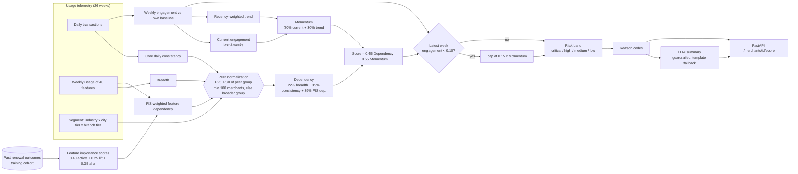
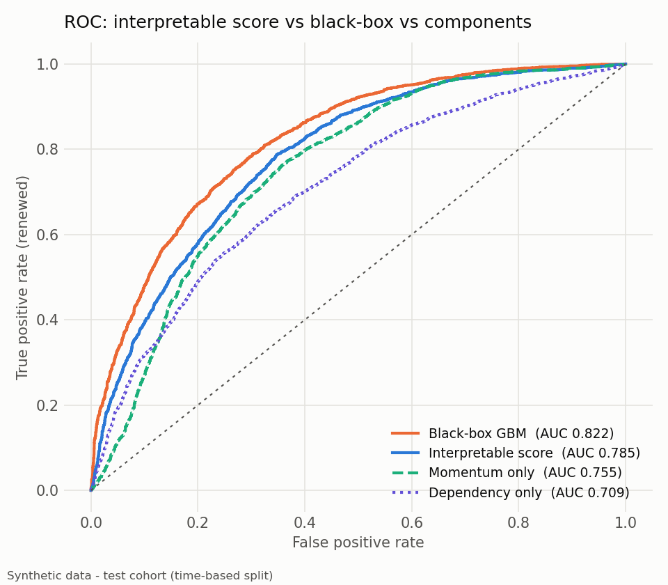
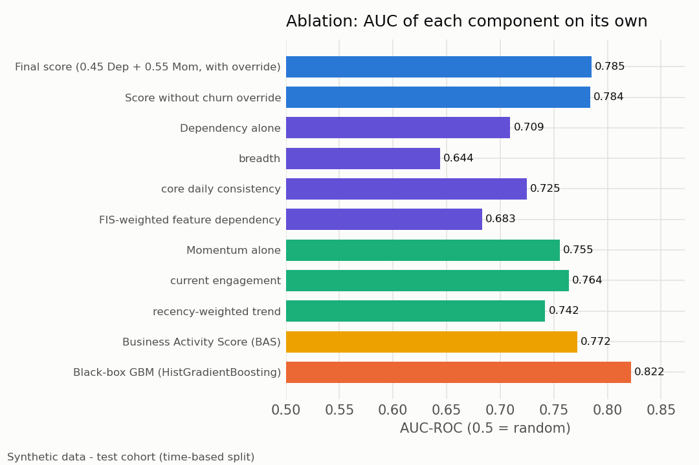
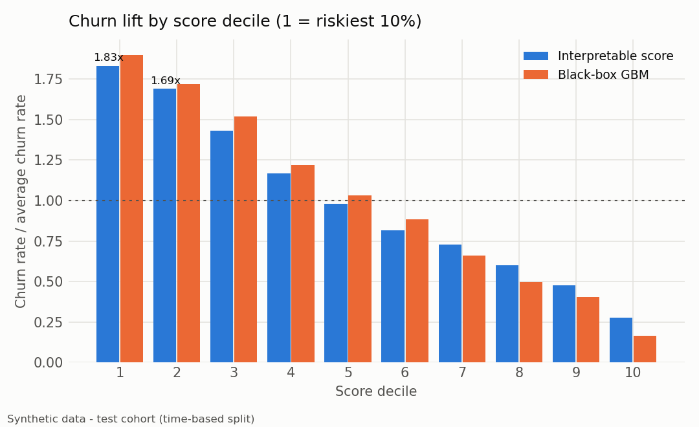
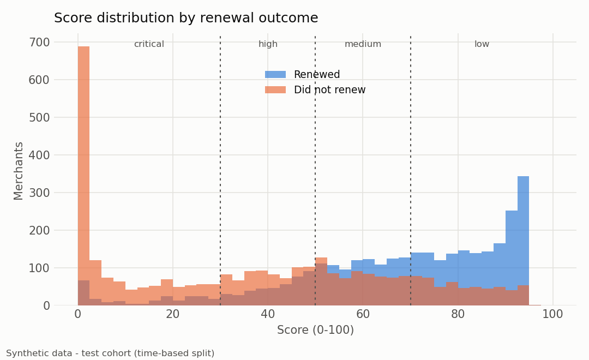
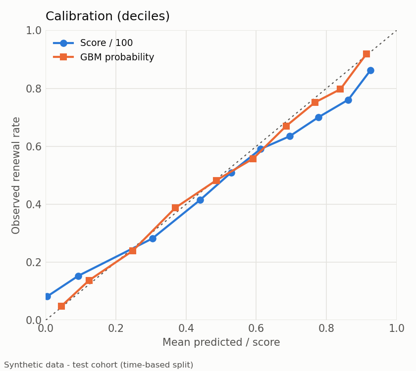

# Merchant renewal scoring

An interpretable renewal-risk score with reason codes for a POS SaaS business
that sells yearly contracts. It includes the evaluation, a black-box benchmark,
an LLM summary layer with guardrails, and a FastAPI service.

> **This is a clean-room rewrite on synthetic data.** No code, data or numbers
> come from any employer. Every result in this repository is computed on data
> produced by [`renewal_scoring/synthetic.py`](renewal_scoring/synthetic.py).

```bash
pip install -r requirements.txt
python -m renewal_scoring.cli all      # ~30 s: generate -> score -> evaluate -> report + charts
pytest                                 # 20 tests
uvicorn renewal_scoring.api:app        # GET /merchants/M000123/score
```

---

## 1. The business problem

Merchants (shops, cafes, pharmacies, small chains) pay for the POS software one
year at a time. Before a contract ends, the renewal team has a few weeks and a
limited number of calls. They need:

1. **A ranked list** of merchants most likely *not* to renew, early enough to act.
2. **The reasons why**, phrased for a salesperson rather than a data scientist
   ("stopped using stock counts, trading on fewer days than similar shops").
3. **Scores they can trust and challenge.** If a salesperson disagrees with a
   score, someone must be able to trace it back to the merchant's usage.

The available signal is product telemetry: daily transactions and weekly usage
of about 40 features in 10 groups (sales, inventory, customers, promotions,
reports, staff, online, finance, loyalty, multi-branch), plus the segment
(industry x city tier x branch tier) and contract type.

## 2. Scoring design



### Components

| Block | Definition | Why |
|---|---|---|
| **Breadth** (22% of Dependency) | number of features used in the window | Many features in use means more switching cost |
| **Core daily consistency** (39%) | share of days with at least one sale | A POS that runs the till every day is hard to replace |
| **FIS-weighted dependency** (39%) | per-feature intensity (log, capped at the P80 of users) weighted by FIS | Not all features are equal: an e-invoice habit matters more than a one-off export |
| **Peer normalization** | each of the three is mapped to `clip((x - P25) / (P80 - P25), 0, 1)` within the merchant's peer group | A pharmacy chain and a single-shop cafe have very different "normal" usage. Peer groups with fewer than 100 merchants fall back to industry x branch tier, then industry, then global |
| **Current engagement** (70% of Momentum) | mean of the weekly engagement over the last 4 weeks, where engagement = 0.5 active-day ratio + 0.5 transaction ratio vs the merchant's own first-13-week baseline (each capped at 1) | Self-relative, so small shops are not penalized for being small |
| **Trend** (30%) | weighted least-squares slope of weekly engagement, weights halve every 8 weeks back, mapped via `0.5 + 0.5 tanh(slope / 0.02)` | Captures gradual decay before it shows up in the level |
| **Churn override** | if the latest week's engagement is < 0.10, `score = min(score, 0.15 x Momentum)` | A shop that stopped trading should not be rescued by a rich usage history |
| **Business Activity Score** (BAS) | 0.40 continuity (`1 - exp(-streak/10)`) + 0.15 intensity (peer percentile of daily transactions) + 0.30 trend + 0.15 stability (1 - CV of weekly sales) | A separate "is the business itself healthy" view for account managers |
| **Bands** | score >= 70 low, 50 to 70 medium, 30 to 50 high, < 30 critical | Each band has its own playbook |

### Feature importance scores (FIS)

[`features.py`](renewal_scoring/features.py) learns, from the training cohort
only, how much each feature says about renewal:

```
FIS = 0.40 * active_signal + 0.25 * retention_lift + 0.35 * aha_signal
```

* `active_signal`: renewal advantage of merchants *currently* using the feature, `(rr_active - rr_base) / (1 - rr_base)`
* `retention_lift`: `tanh(rr_adopters / rr_non_adopters - 1)`. tanh caps it, so a niche feature with a huge ratio cannot dominate
* `aha_signal`: renewal advantage of merchants who used it in at least 3 of their first 8 weeks (an early habit)
* each signal is computed only when its sub-sample has more than 100 merchants, and is 0 otherwise

The weights favour current behaviour (0.40) and early habit (0.35) over raw
adopter lift (0.25), which is the signal most confounded by merchant size. On
the synthetic data, **7 of the top 10 FIS features are exactly the 7 features the
generator secretly made renewal-relevant** (see the [report](reports/evaluation.md#feature-importance-scores-fis-top-10)).

## 3. Why interpretable rules instead of pure ML?

A gradient-boosted model is the obvious alternative, so the repo benchmarks one:
`HistGradientBoostingClassifier` trained on the same raw inputs (216 columns:
26 weeks of transactions and active days, per-feature usage in 3 periods,
segment, contract type), with a **time-based split** (contracts ending before
2025-09-01 train, later ones test).

What the rules give up, and what they buy:

| | Interpretable score | Black-box GBM |
|---|---|---|
| AUC on test cohort (synthetic) | 0.785 | **0.822** |
| Churners found in the riskiest 20% of the list | 35.2% | 36.2% |
| Reason codes | exact, by construction | post-hoc (SHAP), approximate |
| Needs labels to run | only for FIS weights | yes, retrain as behaviour drifts |
| Peer fairness | built in (peer P25..P80) | only if the model learns it |
| A salesperson asks "why 23?" | trace it in one table | "the model says so" |
| Failure mode | misses interactions it was not told about | learns shortcuts that break silently |

The GBM is better, and the gap is real: +0.037 AUC, paired-bootstrap 95% CI
+0.031 to +0.043. But the gap mostly comes from the **middle and the safe end of
the ranking** (see the decile chart). At the top of the list, which is the only part the renewal
team actually calls, the two capture almost the same churners (35.2% vs 36.2%
in the riskiest 20%). For this use case the interpretable score wins:

* every number on the salesperson's screen can be explained and challenged;
* it keeps working when a new feature launches or behaviour shifts, because it
  is anchored to peers and to each merchant's own baseline rather than to last
  year's labels;
* the GBM stays useful as a **challenger**. If its AUC lead grows, the rules are
  missing something, and its feature importances tell you where to look.

## 4. Results on synthetic data

> All figures are from synthetic data (20,000 merchants, seed 42), on the test
> cohort of 6,603 merchants with a 49.9% renewal rate. They show that the method
> works; they are not real-world performance. Full report:
> [`reports/evaluation.md`](reports/evaluation.md).

| Model / component | AUC-ROC | KS |
|---|---|---|
| **Interpretable score** (95% CI 0.774 to 0.795) | **0.785** | **0.440** |
| Score without churn override | 0.784 | 0.436 |
| Dependency alone | 0.709 | 0.312 |
| Momentum alone | 0.755 | 0.405 |
| Business Activity Score | 0.772 | 0.412 |
| Black-box GBM (95% CI 0.812 to 0.831) | 0.822 | 0.487 |

* **Top-decile churn lift: 1.83x** (91.8% churn in the riskiest 10% vs 50.1%
  average). With a ~50% base rate the maximum possible lift is 2.0x.
* **Dependency on its own is weak, Momentum is strong**, and the combination
  beats both. Dependency tells you how embedded the product is; Momentum tells
  you which way the merchant is heading.
* The churn override changes AUC very little, because those merchants already
  score low. Its job is to stop a long, rich history from hiding a shop that
  closed last week: merchants it fires on renew only 10% of the time.
* By hidden churn pattern: 100% of sudden-stop and 92% of gradual-decay
  merchants land in the critical or high bands, against 24% of stable ones.
  Seasonal businesses (34%) are the main source of false alarms, which a
  season-aware baseline would fix.

| ROC: score vs GBM vs components | Ablation |
|---|---|
|  |  |

| Decile lift | Score distribution by outcome |
|---|---|
|  |  |



## 5. Explanations and the LLM layer

[`explain.py`](renewal_scoring/explain.py) follows one rule: **code computes
every fact, the LLM only writes prose.**

1. Reason codes rank components by weighted shortfall, `weight x (1 - value)`:
   `CHURN_OVERRIDE`, `LOW_CORE_CONSISTENCY`, `LOW_TREND`, and so on, plus
   feature-level facts: high-FIS features whose use fell by more than 50%,
   high-value features not in use, and features that support the merchant.
2. An LLM (Gemini or OpenAI through `instructor`, imported lazily; set
   `LLM_PROVIDER=gemini|openai`) fills exactly three fields of a Pydantic schema:
   `headline`, `why` and `next_action`.
3. **Guardrails:** any output containing a number that does not appear in the
   facts, or banned wording ("guarantee", "definitely", "will churn", ...), is
   rejected. The rejection reason goes back to the model as feedback, with up
   to 2 retries; after that the deterministic template is used.
4. **Offline by default.** With no provider configured, the template is used,
   so neither the pipeline nor the API depends on a network call.

```json
{
  "merchant_id": "M000011", "score": 54.0, "band": "medium",
  "reasons": [{"code": "LOW_CURRENT_ENGAGEMENT", "text": "recent activity is well below its own baseline"},
              {"code": "LOW_TREND", "text": "activity has been trending down in recent weeks"}],
  "summary": {"headline": "Medium renewal risk: score 54 of 100",
              "why": "Main drivers: recent activity is well below its own baseline; activity has been trending down in recent weeks. On the positive side, it trades consistently, day after day.",
              "next_action": "Send a usage review and suggest one high-value feature they have not tried yet."}
}
```

## 6. Serving

[`api.py`](renewal_scoring/api.py) is a FastAPI app with three endpoints:

* `GET /health`
* `GET /merchants/{id}/score` returns the score, band, components, reasons and summary
* `GET /metrics` uses real Prometheus metrics if `prometheus_client` is
  installed, and otherwise a minimal text exposition

Responses are cached by an in-process TTL cache. In production the same
interface sits on Redis, so the cache is shared across workers and expires with
the daily snapshot.

```bash
docker build -t renewal-scoring .
docker run -p 8000:8000 renewal-scoring
curl localhost:8000/merchants/M000042/score
```

## 7. Monitoring

Scores are recomputed daily. Before a snapshot is published,
[`monitor.py`](renewal_scoring/monitor.py) runs these drift checks:

* **Band volume:** the number of merchants in each risk band should not move by
  more than +/-10% day over day. A larger move usually means a pipeline or
  upstream data problem, or a real shift the sales team should hear about.
* **Large score drops:** merchants whose score fell by more than 50% *and* by
  at least 20 points go straight to their account manager.
* **Dependency rule checks:** every component is in [0, 1], overridden
  merchants are capped at 15, and no scores are missing.
* Further ideas: input drift on weekly engagement (PSI per segment), the share
  of merchants hitting the churn override, and a monthly backtest against new
  renewal outcomes, with the GBM challenger's AUC gap tracked over time.

## 8. Production version

> Production version: served via FastAPI + Redis with Prometheus/Grafana
> monitoring, validated by backtest (AUC ≈0.83–0.84 on real renewal outcomes);
> this is a clean-room rewrite on synthetic data.

## Repository layout

```
renewal_scoring/
  synthetic.py   seeded generator: segments, contracts, latent health, churn patterns
  features.py    FIS weights + raw matrix for the benchmark
  score.py       peer normalization, Dependency, Momentum, override, BAS, bands
  evaluate.py    AUC, KS, deciles, calibration, bootstrap CI, ablation, GBM benchmark, charts
  explain.py     reason codes, Pydantic schema, guardrails, LLM/template summaries
  monitor.py     daily snapshot drift checks
  api.py         FastAPI service with TTL cache and /metrics
  cli.py         python -m renewal_scoring.cli {generate,score,evaluate,all}
tests/           peer bounds, churn override, guardrails, API smoke test, monitoring
reports/         evaluation.md, metrics.json, fis.csv (generated, committed)
docs/img/        charts (generated, committed)
```

## License

MIT, see [LICENSE](LICENSE).
