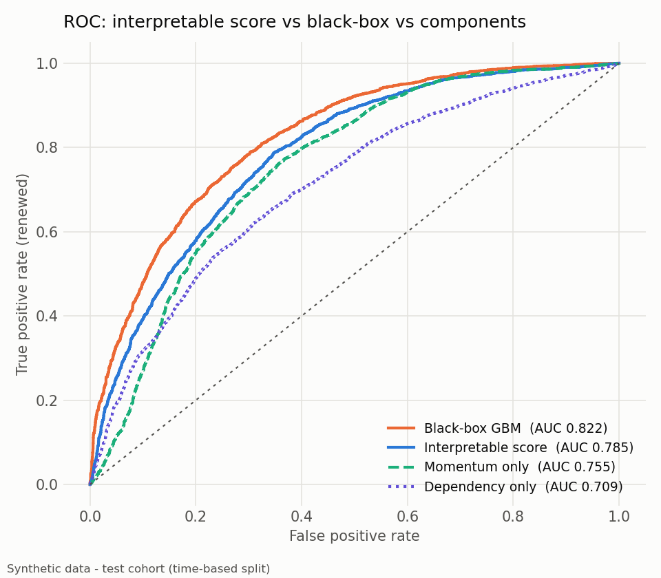
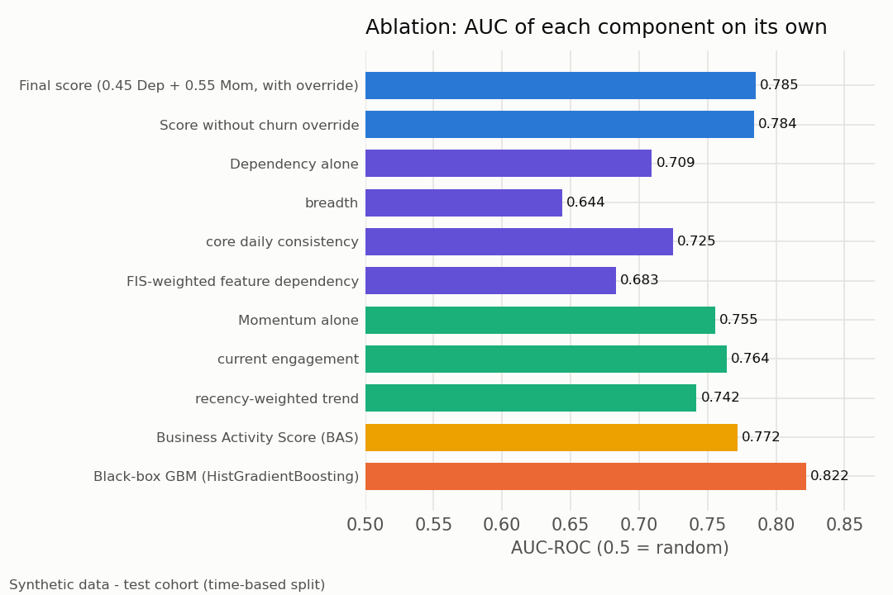
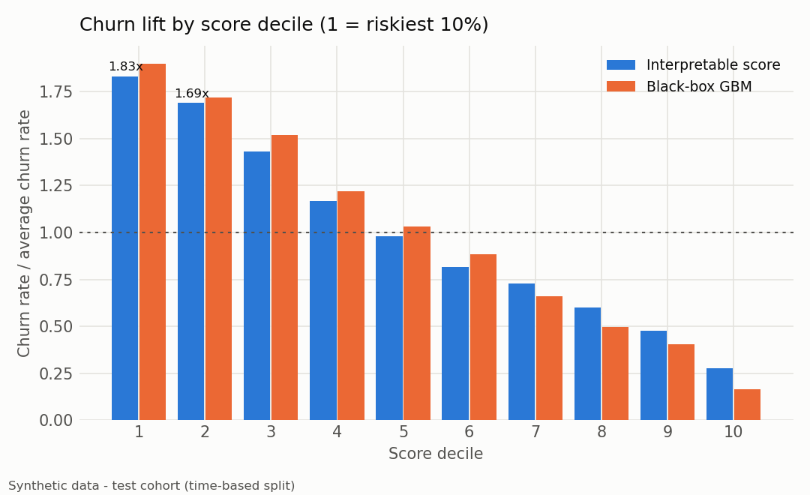
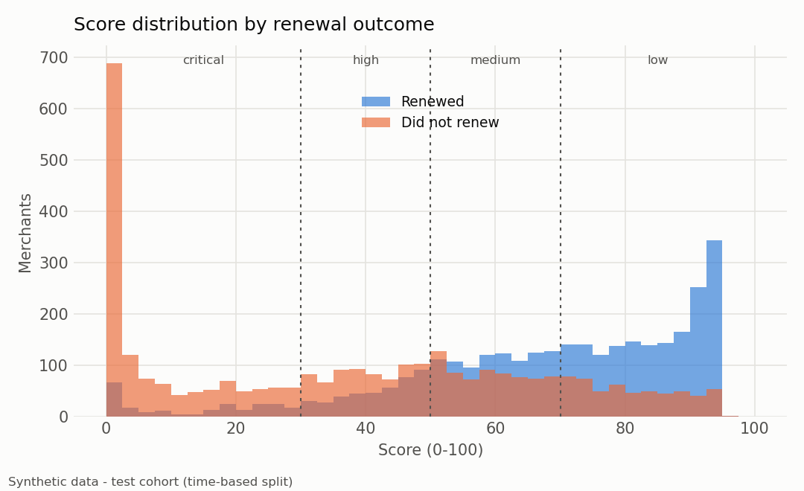
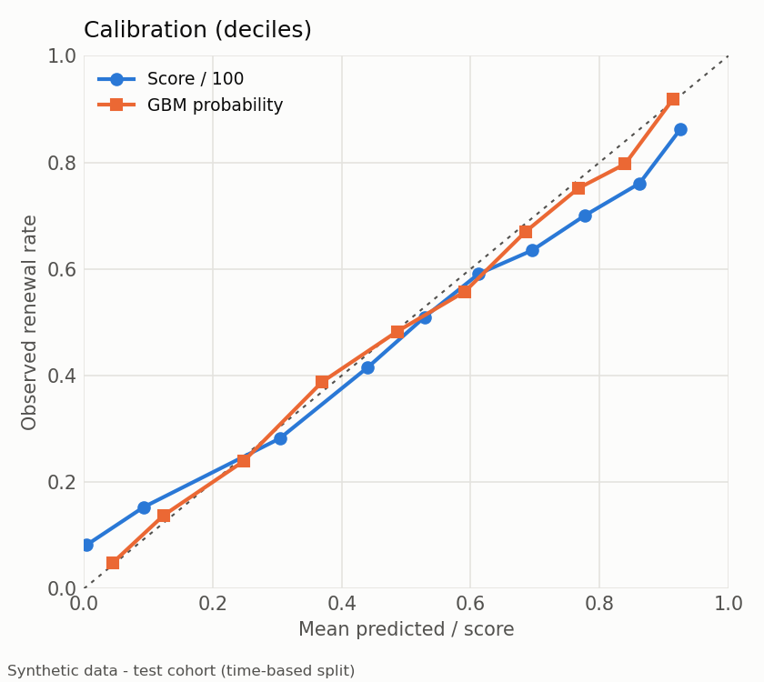

# Evaluation report (synthetic data)

> All numbers below come from **synthetic data** generated by `renewal_scoring.synthetic`.
> They demonstrate the method; they are not results on real merchants.

Time-based split: contracts ending before 2025-09-01 = training cohort
(13,397 merchants, used to derive FIS weights, peer percentiles and to
train the benchmark); contracts ending on/after = test cohort (6,603
merchants, renewal rate 49.9%).

## Headline metrics (test cohort)

| Model | AUC-ROC | 95% bootstrap CI | KS | Top-decile churn lift | Churners caught in riskiest 20% |
|---|---|---|---|---|---|
| Interpretable score | 0.785 | 0.774 - 0.795 | 0.440 | 1.83x | 35.2% |
| Black-box GBM (216 features) | 0.822 | 0.812 - 0.831 | 0.487 | 1.90x | 36.2% |

AUC gap (GBM - score), paired bootstrap: **+0.037**
(95% CI +0.031 to +0.043).

Churn override fired for 14.4% of the test cohort; their renewal
rate was 10.2%.

## Ablation: each component on its own

| description | auc | ks |
|---|---|---|
| Final score (0.45 Dep + 0.55 Mom, with override) | 0.785 | 0.440 |
| Score without churn override | 0.784 | 0.436 |
| Dependency alone | 0.709 | 0.312 |
| breadth | 0.644 | 0.214 |
| core daily consistency | 0.725 | 0.348 |
| FIS-weighted feature dependency | 0.683 | 0.277 |
| Momentum alone | 0.755 | 0.405 |
| current engagement | 0.764 | 0.412 |
| recency-weighted trend | 0.742 | 0.397 |
| Business Activity Score (BAS) | 0.772 | 0.412 |
| Black-box GBM (HistGradientBoosting) | 0.822 | 0.487 |

## Decile lift (interpretable score, decile 1 = riskiest)

| decile | merchants | score_min | score_max | churn_rate | lift | cum_churn_captured |
|---|---|---|---|---|---|---|
| 1 | 661 | 0.000 | 1.600 | 0.918 | 1.833 | 0.183 |
| 2 | 660 | 1.600 | 20.300 | 0.847 | 1.691 | 0.352 |
| 3 | 660 | 20.400 | 38.100 | 0.718 | 1.434 | 0.496 |
| 4 | 660 | 38.100 | 49.100 | 0.585 | 1.167 | 0.612 |
| 5 | 661 | 49.200 | 57.200 | 0.490 | 0.978 | 0.710 |
| 6 | 660 | 57.300 | 65.500 | 0.409 | 0.817 | 0.792 |
| 7 | 660 | 65.500 | 73.400 | 0.365 | 0.729 | 0.865 |
| 8 | 660 | 73.400 | 82.100 | 0.300 | 0.599 | 0.925 |
| 9 | 660 | 82.100 | 90.300 | 0.239 | 0.478 | 0.972 |
| 10 | 661 | 90.300 | 95.900 | 0.138 | 0.275 | 1.000 |

## Risk bands

| band | merchants | renewal_rate | mean_score | share |
|---|---|---|---|---|
| critical | 1607 | 0.145 | 8.460 | 0.243 |
| high | 1106 | 0.373 | 41.069 | 0.167 |
| medium | 1608 | 0.570 | 59.786 | 0.244 |
| low | 2282 | 0.759 | 83.659 | 0.346 |

## By (hidden) churn pattern

The generator's ground-truth trajectory is never shown to the scorer; this table
checks the score reacts to each pattern the way the sales team would expect.

| trajectory | merchants | renewal_rate | mean_score | share_critical_or_high |
|---|---|---|---|---|
| gradual_decay | 1093 | 0.166 | 19.297 | 0.918 |
| growth | 667 | 0.661 | 70.980 | 0.124 |
| seasonal | 676 | 0.605 | 57.866 | 0.337 |
| stable | 3639 | 0.608 | 65.330 | 0.239 |
| sudden_stop | 528 | 0.098 | 1.463 | 1.000 |

## Calibration

The score is a ranking index, not a probability. On this synthetic data score/100
happens to track the observed renewal rate fairly closely in the middle but is
over-confident at both ends (the riskiest decile still renews 8%,
the safest decile still churns 14%).
If the sales team needs a probability, fit an isotonic map from score to renewal
rate on the training cohort rather than reading score/100 as a probability.

## Feature importance scores (FIS), top 10

7 of the top 10 FIS features are among the 7 features the
generator secretly made renewal-relevant.

| feature | group | active_signal | retention_lift | aha_signal | fis | hidden_aha_feature |
|---|---|---|---|---|---|---|
| e_invoice | finance | 0.371 | 0.436 | 0.270 | 0.352 | yes |
| profit_report | reports | 0.315 | 0.420 | 0.227 | 0.311 | yes |
| stock_transfer | multi_branch | 0.311 | 0.345 | 0.268 | 0.305 | yes |
| points_program | loyalty | 0.283 | 0.356 | 0.240 | 0.286 | yes |
| central_pricing | multi_branch | 0.305 | 0.283 | 0.233 | 0.274 |  |
| customer_debt | customers | 0.239 | 0.464 | 0.157 | 0.267 | yes |
| stock_count | inventory | 0.226 | 0.526 | 0.112 | 0.261 | yes |
| tax_report | finance | 0.266 | 0.245 | 0.200 | 0.237 |  |
| shift_handover | staff | 0.300 | 0.219 | 0.172 | 0.235 | yes |
| delivery_partner | online | 0.289 | 0.217 | 0.174 | 0.230 |  |

## Sample explanations (template summaries, offline mode)

**M000000** (critical, score 0, renewed=0)  
- headline: Critical renewal risk: score 0 of 100  
- why: Main drivers: activity in the latest week is close to zero, so the score is capped; recent activity is well below its own baseline.  
- next action: Call the owner this week; confirm whether the store is still trading before discussing renewal.  
- reason codes: CHURN_OVERRIDE, LOW_CURRENT_ENGAGEMENT, LOW_FIS_DEPENDENCY, FEATURE_DROP

**M000004** (high, score 41, renewed=0)  
- headline: High renewal risk: score 41 of 100  
- why: Main drivers: relies little on the features that predict renewal; trades on fewer days than most peers. On the positive side, it keeps recent activity at or above its own baseline.  
- next action: Schedule a check-in call and offer a short training session on the features they stopped using.  
- reason codes: LOW_FIS_DEPENDENCY, LOW_CORE_CONSISTENCY, LOW_BREADTH, FEATURE_DROP

**M000011** (medium, score 54, renewed=0)  
- headline: Medium renewal risk: score 54 of 100  
- why: Main drivers: recent activity is well below its own baseline; activity has been trending down in recent weeks. On the positive side, it trades consistently, day after day.  
- next action: Send a usage review and suggest one high-value feature they have not tried yet.  
- reason codes: LOW_CURRENT_ENGAGEMENT, LOW_TREND, LOW_FIS_DEPENDENCY, FEATURE_DROP

**M000027** (low, score 83, renewed=0)  
- headline: Low renewal risk: score 83 of 100  
- why: Main drivers: activity has been trending down in recent weeks; trades on fewer days than most peers. On the positive side, it keeps recent activity at or above its own baseline.  
- next action: Standard renewal reminder; consider an upsell conversation.  
- reason codes: LOW_TREND, LOW_CORE_CONSISTENCY, LOW_CURRENT_ENGAGEMENT

